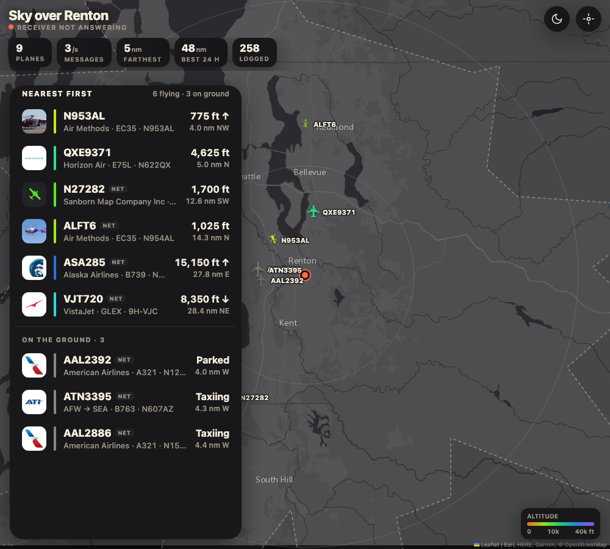
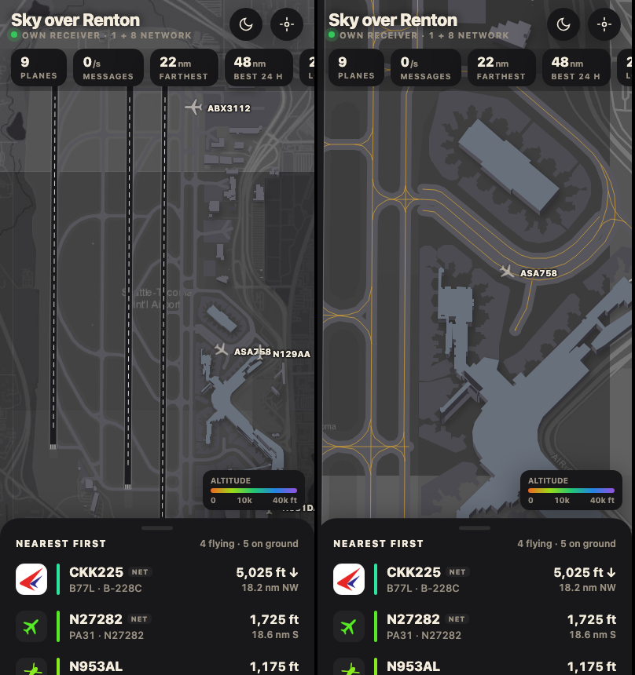

# Sky over Renton

A self-hosted ADS-B flight tracker for the skies above Renton, WA, built as an installable phone app. A $30 software-defined radio on a windowsill hears the aircraft overhead, and a small web app turns that into a live map with real aircraft silhouettes, airline logos, routes and a faux-3D view of SEA, Boeing Field and Renton airports.



**Live: [sky.spenc.ee](https://sky.spenc.ee)** (Add to Home Screen on a phone for the app). The public site is served through a Cloudflare tunnel from a filtered copy of the data that leaves out anything locating the receiver; see `nginx.conf`. This repo is the whole project.

## Hardware

- Nooelec NESDR Mini (RTL2832U / R820T) USB dongle with a small antenna in a window
- Any always-on Linux box running Docker

## Architecture

```
 1090 MHz            +--------------------------- docker compose ---------------------------+
 antenna --> RTL-SDR |  ultrafeeder (readsb + tar1090)      sky-api (stdlib Python, SQLite) |
                     |    /data/aircraft.json                 /api/ac/<hex>  lookups + log   |
                     |    traces, receiver.json               /api/fill      community gaps  |
                     |            \                              /                           |
                     |             +----->  sky-web (nginx)  <--+                            |
                     +----------------------------|---------------------------------------- +
                                                  v
                              web/ PWA (vanilla JS + Leaflet), service worker
```

sky-api looks aircraft up on [adsbdb.com](https://www.adsbdb.com) only when someone taps a plane, and tops up what the antenna cannot hear (parked and taxiing aircraft at SEA/BFI behind terrain, traffic beyond range) from adsb.fi, adsb.lol and airplanes.live. Those feeds are read-only; nothing from the receiver is sent to them.

## Features

- Smooth, dead-reckoned plane motion between receiver updates
- To-scale silhouettes per aircraft type (a 737 is visibly smaller than a 777)
- Faux-3D SEA, BFI and RNT: runways, taxiways, aprons and extruded buildings from OpenStreetMap
- Airline logos, registration, type, owner and photo; a per-airframe sightings log (first seen, days seen)
- Route display that is only shown when it is plausible for where the plane actually is
- A separate "on the ground" section for parked and taxiing aircraft
- Light and dark themes, range ring, altitude color scale
- Add to Home Screen PWA that opens instantly and keeps working on flaky connections



## Tech notes

**Dead reckoning.** The receiver reports a position about once a second per aircraft. Between fixes the app advances each marker along its track at its ground speed on every animation frame, then blends any disagreement with the next real fix in over a short window, so planes glide instead of jumping.

**Route trust.** Callsign-to-route databases are wrong often, because one flight number flies several legs per day. sky-api computes the cross-track distance from the aircraft to the origin-destination great circle and marks the route "trusted" only within `ROUTE_SLACK_NM` (120 nm). Untrusted routes are not shown.

**Silhouettes.** `tools/build_shapes.py` crops and normalizes the outlines in `shapes-src/` (one common scale, about 1 unit per meter) into `web/shapes/`, with an index of sizes, type aliases and ADS-B emitter-category fallbacks. The app scales each icon by real aircraft size, and at airport zoom draws it at true size.

**Faux-3D buildings.** `tools/build_airports.py` pulls aerodrome features from Overpass and writes a compact `web/airports.json` (coordinates rounded to about 1 m). The app draws buildings as extruded footprints with a shifted roof layer and shadow, with the walls shaded by facing. Detail arrives with zoom: runways always, taxiways, then buildings.

**Service worker.** `web/sw.js` precaches the app shell (versioned, so a release replaces the old cache) and keeps a size-capped cache of map tiles. Live data (`/data/`, `/api/`) always goes to the network.

## Setup

1. Plug in the RTL-SDR and create `.env` next to `docker-compose.yml` (see `.env.example`):
   ```
   LAT=47.48
   LON=-122.21
   ```
   Use your real receiver location here; it stays on your machine (`.env` is git-ignored). The app also reads it at runtime from `receiver.json`.
2. `docker compose up -d`, then open `http://<host>:8504/`. The stock tar1090 UI is at `/classic/`.
3. To deploy from another machine to `~/adsb` on a server: `SKY_HOST=user@host ./deploy.sh`.
4. Optional rebuilds: `python3 tools/build_airports.py` (stdlib only) and `python3 tools/build_shapes.py` (needs `cairosvg` and `Pillow`).

Sightings are stored in `state/sky.db` (SQLite).

## Credits

- [OpenStreetMap](https://www.openstreetmap.org/copyright) contributors, ODbL, for the airport data in `web/airports.json`
- [Leaflet](https://leafletjs.com) 1.9.4, BSD-2-Clause, vendored in `web/vendor/leaflet/`
- Basemap tiles by Esri
- [adsbdb.com](https://www.adsbdb.com) for aircraft, airline and route lookups
- [adsb.fi](https://adsb.fi), [adsb.lol](https://adsb.lol) and [airplanes.live](https://airplanes.live) community feeds
- [sdr-enthusiasts/docker-adsb-ultrafeeder](https://github.com/sdr-enthusiasts/docker-adsb-ultrafeeder) (readsb + tar1090)
- [RexKramer1/AircraftShapesSVG](https://github.com/RexKramer1/AircraftShapesSVG), GPL-3.0, source of the aircraft outlines

## License

GPL-3.0, see `LICENSE`. The aircraft silhouettes are derived from GPL-3.0 work, which sets the license for the whole repo.
